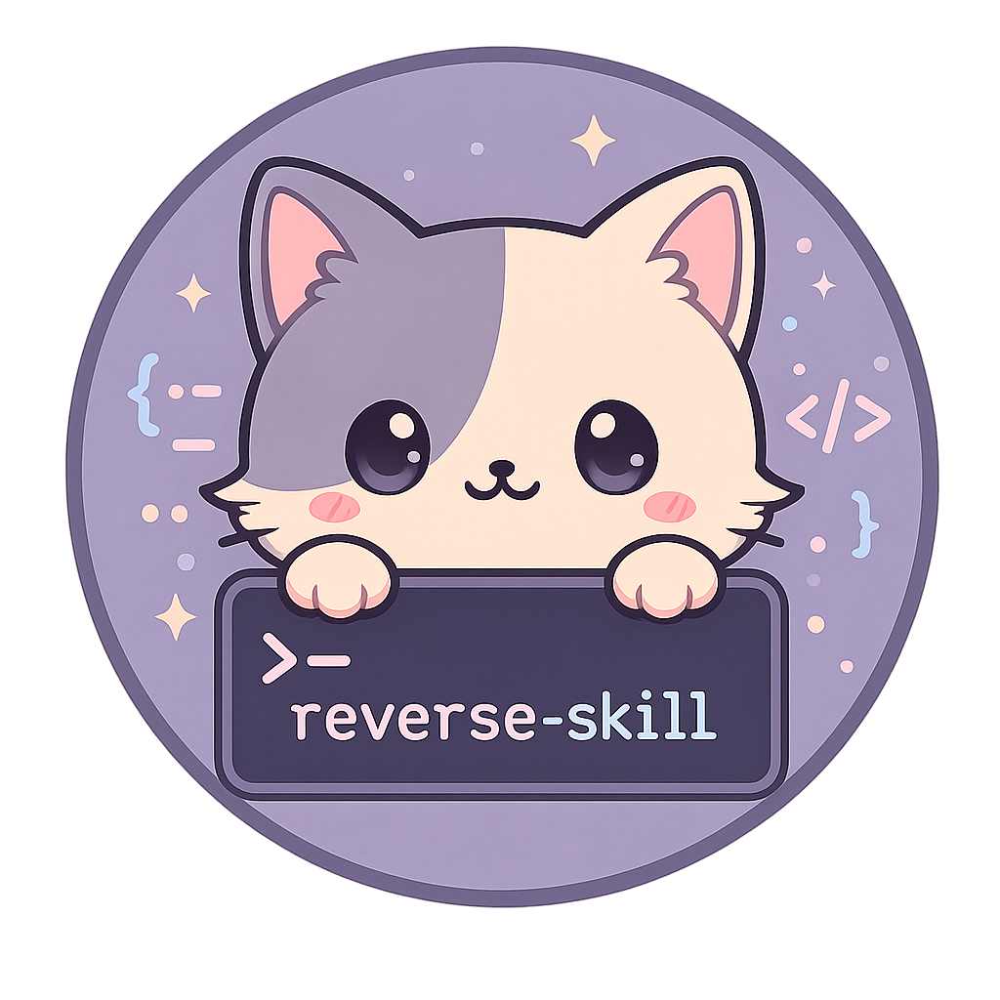

<p align="center">
  
</p>

<h1 align="center">reverse-skill-pro</h1>
<h3 align="center">Reverse Engineering / Authorized Penetration Testing / Security Research Skill Router Pack (Enhanced)</h3>

<p align="center">**English** | [简体中文](README.zh-CN.md)</p>

<p align="center">AI-powered routing · On-demand toolchain bootstrapping · Self-evolving knowledge base · One-shot triage · Parallel orchestration</p>

<p align="center">
  <a href="VERSION"></a>
  <a href="LICENSE"></a>
  <a href="https://github.com/Leechuihui/reverse-skill-pro/actions/workflows/ci.yml"></a>
  <a href="#verification"></a>
</p>

<br/>

<a id="about"></a>

## About

When an AI agent (Claude Code, Codex, Cursor, OpenCode, or any compatible client) faces an APK, binary, frontend JS crypto, CTF, or pentest task, this system routes it to the right methodology first, then drives local tools — instead of blindly guessing commands.

```text
User task / sample file
  → RULES.md
  → MASTER-ROUTING / master-route.ps1 (PRIMARY)
  → quick-triage.ps1 (file in hand: magic bytes → type routes → tool check)
  → case-init / scope.md (auth + network_profile; no ACT until granted)
  → target Skill → tools / MCP / scripts
  → timeline + Evidence→Finding→Path → report + field-journal
```

**Three pain points solved:**
- Agents don't know whether to use jadx, Frida, or IDA when facing APK/ELF/JS/PCAP
- Tool paths, MCP services, and script entries are scattered across machines
- The same lessons are re-learned every time; experience never compounds

<a id="status"></a>

## Current status

| Routing rules | Regression benchmark | Core skill modules | CI platforms | Client model |
|---:|---:|---:|---|---|
| 47 (R0–R48) | 189 cases | 48 tracked modules | Windows + Ubuntu | Client-neutral |

PRIMARY ladder: [skills/MASTER-ROUTING.md](skills/MASTER-ROUTING.md) · Full matrix: [skills/routing.md](skills/routing.md) · Ops: [skills/ops/](skills/ops/)

<br/>

<a id="pro-enhancements"></a>

## Pro enhancements

| Enhancement | Content |
|--------|------|
| New skill R45 `fuzzing/` | AFL++/libFuzzer/honggfuzz/boofuzz/syzkaller end-to-end: harness templates, seeding, crash triage, ASan reading |
| New skill R46 `emulation/` | unidbg/Qiling/Unicorn emulation: so/JNI algorithm recovery with env patching, anti-emulation countermeasures |
| New skill R47 `crypto-analysis/` | RSA/ECC/lattice attacks, padding oracle, classical ciphers, PRNG recovery, identification trio |
| New skill R48 `stego-analysis/` | Image/audio/document stego five-step check & extraction, PNG fix / WAV LSB scripts |
| One-shot triage | `skills/scripts/quick-triage.ps1/.sh`: magic bytes → type routes → tool check → report |
| Case resume | `skills/scripts/case-resume.ps1/.sh`: auth/timeline/workitems/evidence state restore |
| MCP presets | `skills/config/mcp-presets.json`: wiring info for 8 common security MCPs + client snippets |
| Parallel orchestration | `skills/references/parallel-orchestration.md`: RE fan-out / recon fan-out / CTF dual-track |

<br/>

<a id="quick-start"></a>

## Quick start

### Prerequisites

- **Java / JDK** — jadx, apktool
- **Node.js 22.12+** — JS toolchain and MCP services
- **Python 3.x** — Frida and helper scripts
- **A coding AI client** — Claude Code, Codex, Cursor, OpenCode, or any compatible client

### Install

```bash
git clone https://github.com/Leechuihui/reverse-skill-pro.git
```

### First use

> After downloading, just ask your AI to read [README_AI.md](README_AI.md) — it will complete routing and tool checks for the current environment.

Platform notes:
- **Kali Linux** → [kali/README-kali.md](kali/README-kali.md)
- **Ubuntu/Debian** → [docs/platforms/linux.md](docs/platforms/linux.md)
- **macOS** → [docs/platforms/macos.md](docs/platforms/macos.md)

<br/>

<a id="usage"></a>

## Usage

### Supported scenarios

| Scenario | Entry |
|------|------|
| APK / Android reverse | `skills/apk-reverse/` |
| iOS / mobile | `skills/mobile-reverse/` |
| Binary reverse (exe/dll/so/elf) | `skills/ida-reverse/` / `skills/radare2/` |
| .NET / C# | `skills/dotnet-reverse/` |
| Frontend JS signature / crypto params | `skills/js-reverse/` |
| DSL VM / risk-control custom VM | `skills/reverse-engineering/dsl-vm-reverse/` |
| HTTP capture / request replay | anything-analyzer, Reqable MCP + `js-reverse/` |
| Malware / YARA | `skills/malware-analysis/` |
| Pentest / vuln scanning | `skills/pentest-tools/` |
| Attack chain / red team orchestration | `skills/attack-chain/` |
| Case evidence review / handoff | `skills/case-review/` |
| CTF competitions | `CTF-Sandbox-Orchestrator/` (42 sub-skills) |
| Firmware / IoT | `skills/firmware-pentest/` |
| Patch diff / N-day | `skills/patch-diff-exploit/` |
| Pwn / exploitation | `skills/pwn-chain/` |
| EDR bypass research | `skills/edr-bypass-re/` |
| API / GraphQL | `skills/api-security/` |
| Supply chain / SBOM | `skills/supply-chain-security/` |
| LLM / AI security | `skills/llm-security/` |
| Fuzzing | `skills/fuzzing/` |
| unidbg / Qiling emulation | `skills/emulation/` |
| Crypto analysis & attacks | `skills/crypto-analysis/` |
| Stego analysis | `skills/stego-analysis/` |
| OLLVM deobfuscation | `skills/reverse-engineering/references/ollvm-deobfuscation.md` |
| Diagrams / reports | `skills/diagram-generator/` / `skills/docs-generator/` |

### Key files

| File | Purpose |
|------|------|
| [README_AI.md](README_AI.md) | AI agent onboarding (agents must read) |
| [RULES.md](RULES.md) | Global routing rules |
| [skills/MASTER-ROUTING.md](skills/MASTER-ROUTING.md) | PRIMARY ladder |
| [skills/routing.md](skills/routing.md) | Routing matrix (scenario → skill) |
| [skills/SKILL.md](skills/SKILL.md) | Master control entry |
| [skills/INDEX.md](skills/INDEX.md) | Auto-generated skill navigation index |
| [skills/config/routing.json](skills/config/routing.json) | Routing single source of truth (47 rules, R0–R48) |
| [skills/config/mcp-presets.json](skills/config/mcp-presets.json) | MCP preset wiring profiles |
| [skills/tool-index.md](skills/tool-index.md) | Local tool index (auto-generated) |
| [skills/scripts/master-route.ps1](skills/scripts/master-route.ps1) | Keyword router |
| [skills/scripts/quick-triage.ps1](skills/scripts/quick-triage.ps1) | Artifact one-shot triage (magic + type + tools) |
| [skills/scripts/case-init.ps1](skills/scripts/case-init.ps1) | Case workspace (scope/timeline) |
| [skills/scripts/case-resume.ps1](skills/scripts/case-resume.ps1) | Case resume |
| [skills/references/parallel-orchestration.md](skills/references/parallel-orchestration.md) | Parallel sub-agent orchestration templates |
| [skills/scripts/test-routing.ps1](skills/scripts/test-routing.ps1) | 189-case routing regression benchmark |
| [skills/ops/](skills/ops/) | Scope / evidence chain / roles / timeline / skill supply chain |

### Repository layout

```text
.
├── README.md / README_zh.md / README_AI.md
├── RULES.md / RULES_zh.md        # global routing (with scope gate)
├── skills/
│   ├── MASTER-ROUTING.md         # PRIMARY ladder
│   ├── SKILL.md / routing.md     # master control + three-axis matrix
│   ├── ops/                      # scope / evidence / roles / timeline
│   ├── scripts/                  # master-route / quick-triage / case-init / case-resume / bootstrap
│   ├── config/                   # routing.json + mcp-presets.json
│   ├── references/               # parallel orchestration / community skills map
│   ├── field-journal/            # anonymized lessons
│   ├── fuzzing/ emulation/ crypto-analysis/ stego-analysis/   # pro additions
│   └── ... (44 domain skills)
├── CTF-Sandbox-Orchestrator/     # CTF sub-skills
├── burp-mcp-full/                # Burp extension source
├── docs/                         # platforms & architecture
└── kali/                         # Kali scripts
```

<br/>

<a id="license"></a>

## ⚖️ License

This project is released under the **MIT License** (see [LICENSE](LICENSE)).

**Submodules & third-party dependencies:**
- **CTF-Sandbox-Orchestrator/**: **GNU GPLv3**
- Bundled tools (jadx, frida, nmap, etc.) follow their respective licenses

## Disclaimer

This project is intended solely for lawful security research, education, CTF competitions, and testing of systems you own or have explicit authorization to test.

**Unauthorized access, scanning, exploitation, interference, or data exfiltration is strictly prohibited.** Users are solely responsible for ensuring compliance with applicable laws and authorization scope; the authors assume no liability for misuse.
